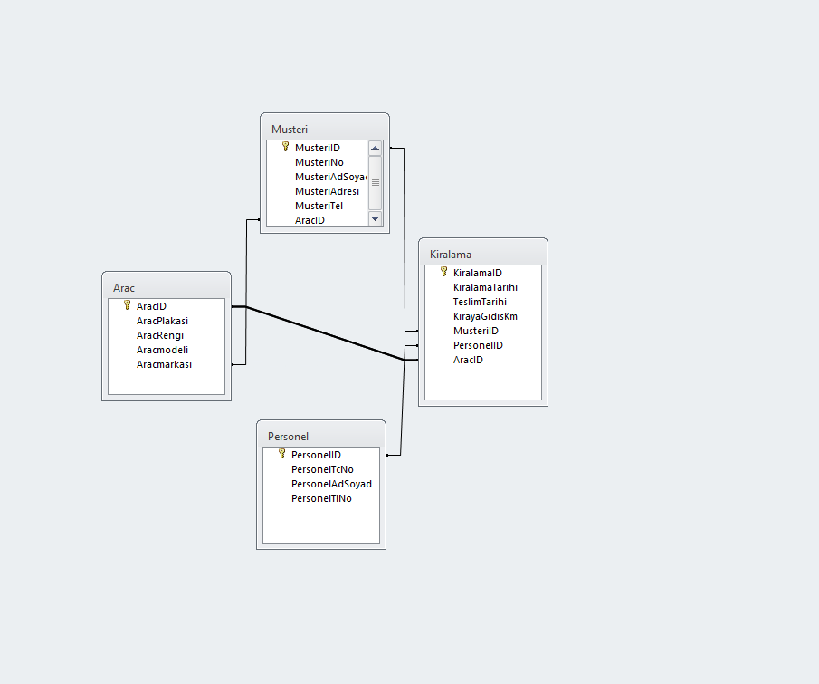

# Veritabani Normalizasyon Tablo Semasi

Bu depo, iliskisel veritabani tasariminda fonksiyonel bagimliliklarin giderilmesi ve normalizasyon asamalarinin (1NF, 2NF, 3NF) sutun ve tablo bazinda nasil uygulandigini gosteren ornek tablo semasini icermektedir.

## Tablo Semasi

## Onerilen Islem

Bu calisma tek bir sema gorselinden olustugu icin mustakil bir yazilim projesi niteligi tasimamaktadir. Profilinizin profesyonel gorunumu acisindan `nf-kurallar-` calismasi ile birlikte `algoritma-ve-veritabani-temelleri` cati deposuna tasinmasi ve bu deponun arsivlenmesi (Archive) tavsiye edilir.
